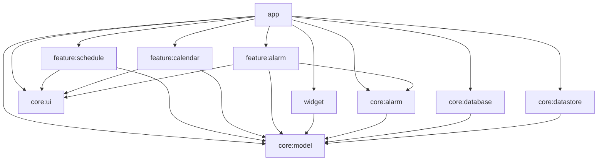

# Архитектура shift-alarm

Android-only приложение на Jetpack Compose. Это не Kotlin Multiplatform: модули собираются Android Gradle Plugin, кроме `:core:model`, который остаётся обычной JVM-библиотекой, чтобы чистые функции и тесты не тянули Android.

Сети нет. В манифесте нет `INTERNET`, логина, рекламы и Firebase. Если зависимость попытается протащить `INTERNET`, `ACCESS_NETWORK_STATE` или `AD_ID`, приложение вырезает их через `tools:node="remove"`.

Идентификаторы: `applicationId` и `namespace` приложения — `com.walhalla.shiftalarm`. `minSdk` 24, `targetSdk` 36, `compileSdk` 36.

## Граф модулей

Стрелка значит «зависит от». Фичи не зависят друг от друга и не видят Room/DataStore. Единственная точка сборки — `:app`.



## Правила слоёв

- `:core:model` не импортирует Android. Там домен, `ShiftCalculator`, `NextAlarmPlanner`, интерфейсы репозиториев и `HomeWidgetRefresher`.
- `:core:database` и `:core:datastore` реализуют репозитории. Наружу их классы не торчат: фичи получают интерфейсы через Koin.
- `:core:alarm` владеет `AlarmScheduler`, `AlarmManager` и foreground-сервисом звонка. Он не знает про Compose и не зависит от фич. Экран звонка открывается через `RingingLaunchIntent`, реализацию которого даёт `:feature:alarm`.
- Фича не зависит от другой фичи. Навигацию между ними собирает `:app`.
- Виджет не зависит от фич. Данные он берёт из `ShiftRepository` и считает завтра через `ShiftCalculator`.
- Состояние экрана — `ViewModel` и `StateFlow<UiState>`. Компоненты не ходят в Room.

## DI: Koin

Решение пользователя (T10g): DI только Koin 4.1.0, Hilt и kapt не используются. KSP остаётся только в `:core:database` для Room.

- У каждого Gradle-модуля свой Koin-модуль: `databaseModule`, `dataStoreModule`, `alarmModule`, `alarmFeatureModule`, `scheduleModule`, `calendarModule`, `widgetModule`. `:app` собирает их в `shiftAlarmModules` (`AppModule.kt`).
- `startKoin` вызывается в `ShiftAlarmApp.onCreate`, поэтому граф есть у ресиверов, `RingingService`, виджета и direct boot.
- ViewModel регистрируются через `viewModel { }` из `org.koin.core.module.dsl`. В Compose их берут через `koinViewModel()`, в Activity через `by viewModel()`.
- Ресиверы, `RingingService` и Glance-виджет реализуют `KoinComponent` и берут зависимости через `by inject()`. Конструкторы классов без DI-аннотаций.
- Скоуп приложения: `single(ApplicationScope) { CoroutineScope(SupervisorJob() + Dispatchers.Default) }`, где `ApplicationScope = named("ApplicationScope")`.
- Koin проверяет граф в рантайме, а не при компиляции. Поэтому `KoinGraphTest` в `:app` вызывает `verify(extraTypes = listOf(Context::class, File::class))`. Новый биндинг без зелёного `KoinGraphTest` не мёржится.
- Реализацию интерфейса регистрируем по конкретному классу: `single { Impl(get()) } bind Api::class`. Запись `single<Api> { Impl(get()) }` запрещена: `verify()` видит только тип `Api` без конструктора и пропущенную зависимость `Impl` не ловит.

## Домен и шаблоны

`ShiftType` — слот цикла: `DAY`, `NIGHT`, `AFTER_NIGHT` (отсыпной), `OFF` или `CUSTOM` со своим именем и цветом. Цвет — пара непрозрачных ARGB `Long`: `colorLight` и `colorDark` (`0xAARRGGBB`, не упакованный цвет Compose). `startTime: LocalTime?` — начало смены; `null` у `OFF` и `AFTER_NIGHT`, они не звонят. `alarmLeadMinutes` — упреждение 0..1440 минут, по умолчанию 90. Отдельного поля `alarmTime` нет.

Встроенные пары: день `#A16207` / `#F4B000`, ночь `#1E3A8A` / `#3B82F6`, отсыпной `#0F766E` / `#0D9488`, сутки `#312E81` / `#6366F1`. Выходной в обеих темах `#6B7280`. Свой тип, у которого был один `colorArgb`, после миграции получает этот цвет и в светлой, и в тёмной теме.

`ShiftPattern` — упорядоченный цикл и `startDate` (этот день соответствует индексу 0). Даты до старта тоже попадают в цикл через `floorMod`.

| Шаблон | Цикл, один слот = один календарный день |
| --- | --- |
| 2/2 | День 07:00, Ночь 19:00, Отсыпной, Выходной. Упреждение 90 минут: будильник 05:30 и 17:30 |
| 3/3 | День, День, День, Выходной, Выходной, Выходной |
| 1/3, сутки-трое | Сутки 08:00, Отсыпной, Выходной, Выходной. Будильник суток 06:30 |
| 5/2 | пять Дней и два Выходных, якорь — `startDate`, не понедельник |
| CUSTOM | любой непустой цикл, `ShiftTemplates.custom` |

Исключение на дату (`DayOverride`) заменяет слот паттерна целиком и не привязано к id графика: это свойство календарного дня. `AlarmException` на ту же дату либо глушит будильник (`enabled = false`), либо подменяет его абсолютным `customTime: LocalDateTime`. Это не «время внутри дня смены», а готовая локальная дата-время.

Момент звонка считает только `ShiftAlarms`. Старт смены — `ZonedDateTime.of(shiftDate, startTime, zone)`, затем минус `alarmLeadMinutes`. Вычитание идёт по временной шкале, поэтому ночная смена 00:30 с упреждением 90 минут звенит в 23:00 предыдущего дня. Поле `alarmTime` удалено.

Правила DST считаются в системной зоне:

- весенний провал (несуществующее локальное время) сдвигается вперёд на длину провала — так делает `ZonedDateTime.of`;
- осеннее перекрытие: номинальный момент берёт более раннее смещение (`ZonedDateTime.of`);
- если этот ранний момент уже не позже `now`, `NextAlarmPlanner` пробует то же локальное время с `withLaterOffsetAtOverlap()` в тот же календарный день. Следующий день берётся только когда и позднее смещение уже прошло. Пример: 2026-10-25 02:45 в Europe/Berlin, `now` между первым и вторым наступлением — звонок в 02:45+01:00 того же дня, а не через сутки.

`TIME_SET` и `TIMEZONE_CHANGED` заново вызывают `scheduleNext`, поэтому после перевода часов момент пересчитывается.

```kotlin
object ShiftCalculator {
    fun shiftFor(
        date: LocalDate,
        pattern: ShiftPattern,
        overrides: Map<LocalDate, DayOverride> = emptyMap(),
        zone: ZoneId = ZoneId.systemDefault(),
    ): ResolvedShift
}

object ShiftAlarms {
    fun instant(shiftDate: LocalDate, shift: ShiftType, zone: ZoneId): ZonedDateTime?
    fun exceptionInstant(customTime: LocalDateTime, zone: ZoneId): ZonedDateTime
}
```

Пустой цикл — `IllegalArgumentException`. Тесты лежат в `:core:model` и гоняются на JVM.

Единственный планировщик — `NextAlarmPlanner.earliest(now, pattern, overrides, exceptions)`. Он смотрит примерно два цикла вперёд от локальной даты `now` (минимум два дня) и выбирает самый ранний момент строго после `now`, а не первый подходящий день. Смена, которая начинается завтра после полуночи, может выиграть уже сегодня вечером. `NextTriggerSelector` оставляет один триггер: будущий snooze важнее этого момента. Другого пути расчёта нет: и разблокированное хранилище, и direct boot идут через `earliest`.

## Хранение

Room (`shift-alarm.db`, схема версии 3 в `core/database/schemas`, миграции `1 → 2` и `2 → 3`) хранит то, что выбирают по дате и связывают:

- `shift_types` — встроенные и пользовательские типы;
- `patterns` и `pattern_slots` — цикл и флаг единственного активного графика;
- `day_overrides` — подмена смены на дату;
- `alarm_exceptions` — подмена или отмена будильника на дату.

Это строки с внешними ключами и выборкой «все дни месяца». Класть тот же граф в DataStore означало бы каждый раз переписывать весь документ.

DataStore Preferences (`shift_alarm_settings`) хранит скаляры, которые не ищутся по дате: минуты snooze, вибрацию, флаг `use_dynamic_color` (по умолчанию включён) и один маркер отложенного звонка (`pending_snooze_epoch_millis`, имя смены). Маркер нужен, чтобы после перезагрузки `scheduleNext` снова поставил именно snooze, а не сразу следующую смену. Это не таблица истории будильников.

Активный график живёт в Room (`patterns.isActive`), а не в DataStore. `saveAndActivate` снимает прежний активный флаг, пишет типы, паттерн и слоты одной `@Transaction`. Если слот ссылается на отсутствующий тип, транзакция откатывается и прежний график остаётся активным.

## Контракты для UI и feature

Репозитории (`:core:model`):

```kotlin
interface ShiftRepository {
    fun observePatterns(): Flow<List<ShiftPattern>>
    fun observeActivePattern(): Flow<ShiftPattern?>
    fun observeShiftTypes(): Flow<List<ShiftType>>
    fun observeOverrides(): Flow<List<DayOverride>>
    suspend fun upsertPattern(pattern: ShiftPattern)
    suspend fun setActivePattern(patternId: String?)
    suspend fun saveAndActivate(pattern: ShiftPattern)
    suspend fun upsertOverride(override: DayOverride)
    suspend fun deleteOverride(date: LocalDate)
}

interface AlarmRepository {
    fun observeExceptions(): Flow<List<AlarmException>>
    suspend fun upsertException(exception: AlarmException)
    suspend fun deleteException(date: LocalDate)
}

interface SettingsRepository {
    val settings: Flow<UserSettings>
    suspend fun setSnoozeMinutes(minutes: Int)
    suspend fun setVibrationEnabled(enabled: Boolean)
    suspend fun setUseDynamicColor(enabled: Boolean)
    suspend fun setPendingSnooze(epochMillis: Long?, shiftName: String)
}

interface HomeWidgetRefresher {
    suspend fun refresh()
}
```

Планировщик (`:core:alarm`). В очереди AlarmManager всегда не больше одного будильника.

```kotlin
interface AlarmScheduler {
    suspend fun scheduleNext(nowEpochMillis: Long = System.currentTimeMillis())
    suspend fun cancelNext()
    suspend fun snooze(minutes: Int, shiftName: String)
    suspend fun dismiss()
    fun canScheduleExactAlarms(): Boolean
    fun canUseFullScreenIntent(): Boolean
}

interface RingingController {
    fun stop()
    fun snooze()
}

interface RingingLaunchIntent {
    fun create(shiftName: String, triggerAtEpochMillis: Long, snooze: Boolean): Intent
}
```

`AlarmPermissionIntents.requestExactAlarm` и `manageFullScreenIntent` открывают системные экраны. На API, где действия нет, методы возвращают `null`.

Состояние экранов — неизменяемые data class, их публикует `StateFlow`:

```kotlin
data class ScheduleUiState(
    val isLoading: Boolean = true,
    val patterns: List<PatternSummary> = emptyList(),
    val activePatternId: String? = null,
    val editor: PatternEditorUiState? = null,
    val errorMessage: String? = null,
)

data class CalendarUiState(
    val isLoading: Boolean = true,
    val month: YearMonth = YearMonth.now(),
    val days: List<CalendarDayUi> = emptyList(),
    val selected: CalendarDayUi? = null,
    val selectedDay: SelectedDayDetail? = null,
    val hasActivePattern: Boolean = false,
    val errorMessage: String? = null,
)

data class SettingsUiState(
    val isLoading: Boolean = true,
    val snoozeOptions: List<Int> = listOf(5, 10, 15, 20, 30),
    val selectedSnooze: Int = 10,
    val vibrationEnabled: Boolean = true,
    val useDynamicColor: Boolean = true,
    val canScheduleExactAlarms: Boolean = true,
    val canUseFullScreenIntent: Boolean = true,
    val errorMessage: String? = null,
)

sealed interface RingingUiState {
    data object Loading : RingingUiState
    data class Ringing(
        val shiftName: String,
        val triggerAtEpochMillis: Long,
        val snoozeMinutes: Int,
    ) : RingingUiState
    data class Error(val message: String) : RingingUiState
}
```

Маршруты NavHost, объект `ShiftRoutes` в `:core:ui`:

| Константа | Маршрут | Кто рисует |
| --- | --- | --- |
| `SCHEDULE` | `schedule` | `ScheduleRoute()` |
| `CALENDAR` | `calendar` | `CalendarRoute()` |
| `SETTINGS` | `settings` | `SettingsRoute()` в `:app` |

Звонок не маршрут NavHost. Его открывает `RingingActivity` (`singleInstance`, `showWhenLocked`, `turnScreenOn`, на API 24–26 те же флаги окна выставляются в коде).

Публичные composable фич: `ScheduleRoute`, `CalendarRoute`. Экран звонка — `RingingScreen(state, onStop, onSnooze)`.

## Жизненный цикл будильника

Планировщик ставит только следующий момент, через `AlarmManager.setAlarmClock`. Повтор всей серии в AlarmManager не кладётся.

1. `AlarmRescheduleWatcher` — единственный владелец пересчёта после записи. Его стартует `ShiftAlarmApp`. Он смотрит потоки паттернов, активного графика, подмен, исключений и настроек. `saveAndActivate`, `setOverride`, `clearOverride`, `setAlarmException` и `clearAlarmException` меняют эти потоки, watcher вызывает `scheduleNext(now)`, а тот заново пишет device-protected снимок. Экраны сами `scheduleNext` не зовут. Те же пять системных action по-прежнему приходят в `RescheduleReceiver`, и он тоже вызывает `scheduleNext(now)`.
2. `scheduleNext(now)` читает активный паттерн, подмены дней, исключения будильника и маркер snooze. Если snooze строго позже `now` — ставится он. Иначе `NextAlarmPlanner.earliest` ищет ближайший момент. Нет кандидата — pending intent отменяется. В AlarmManager всегда один будильник.
3. Если `canScheduleExactAlarms()` истинно, ставится `setAlarmClock`. Если ложно или `setAlarmClock` бросает `SecurityException`, ставится неточный запасной: сначала `setAndAllowWhileIdle`, при ошибке `setWindow` на 15 минут. Рядом показывается heads-up, что точные будильники выключены, и тап ведёт в системный запрос разрешения. Когда точные снова доступны, это уведомление снимается.
4. Срабатывание приходит в `AlarmFireReceiver` (явный `PendingIntent`, `FLAG_IMMUTABLE`, `exported=false`). Он поднимает `RingingService` (`startForeground` с типом `specialUse`) и сразу вызывает `scheduleNext(now = время этого срабатывания)`, чтобы следующий слот встал, даже если пользователь не нажмёт «Стоп». Момент строго после `now`, поэтому тот же звонок не ставится ещё раз.
5. Сервис берёт `PARTIAL_WAKE_LOCK` (потолок 10 минут) и системный звук будильника. Если `canUseFullScreenIntent()` истинно (ниже API 34 это всегда так), уведомление категории `alarm` открывает `RingingActivity` через full-screen intent. Если на API 34+ разрешение снято, full-screen intent не ставится: то же уведомление уходит как heads-up (`PRIORITY_MAX`, канал `IMPORTANCE_HIGH`). Вибрация выбирает один из двух каналов.
6. «Стоп» вызывает `dismiss()`: маркер snooze стирается, снова считается следующая смена. «Отложить» пишет snooze в DataStore и заменяет единственный pending alarm. И активность, и кнопки уведомления идут в один `RingingService`.

`LOCKED_BOOT_COMPLETED` приходит до разблокировки, и будильник ставится из device-protected снимка. `BOOT_COMPLETED` приходит уже после разблокировки: credential-хранилище доступно, снимок при необходимости переносится в Room. `USER_UNLOCKED` манифест не слушает: платформа не доставляет его manifest-receiver.

## Матрица разрешений

| Разрешение | API | Как выдаётся | Зачем |
| --- | --- | --- | --- |
| `RECEIVE_BOOT_COMPLETED` | 24+ | manifest, normal | `RescheduleReceiver` после загрузки |
| `WAKE_LOCK` | 24+ | manifest, normal | не дать CPU уснуть, пока звенит |
| `VIBRATE` | 24+ | manifest, normal | канал с вибрацией |
| `FOREGROUND_SERVICE` | 24+ | manifest, normal | сервис звонка |
| `SCHEDULE_EXACT_ALARM` | 31–32, `maxSdkVersion=32` | специальное, экран настроек | `setAlarmClock`; проверять `canScheduleExactAlarms()` |
| `USE_EXACT_ALARM` | 33+ | normal, для будильника обычно уже выдано | то же `canScheduleExactAlarms()` |
| `POST_NOTIFICATIONS` | 33+ | runtime | без него уведомление и full-screen intent не появятся |
| `USE_FULL_SCREEN_INTENT` | 34+ | специальное, может быть отозвано | `canUseFullScreenIntent()`; на 24–33 полный экран доступен без этого разрешения |
| `FOREGROUND_SERVICE_SPECIAL_USE` | 34+ | manifest | тип сервиса `specialUse`, subtype `shift_alarm_ringing` |

До API 31 `canScheduleExactAlarms()` возвращает true: `setAlarmClock` на этих версиях не требует отдельного разрешения. Отдельного типа FGS «alarm» у платформы нет, поэтому звонок объявлен как `specialUse`.

`RescheduleReceiver` — `exported=true` только ради пяти защищённых системных action: `LOCKED_BOOT_COMPLETED`, `BOOT_COMPLETED`, `TIME_SET`, `TIMEZONE_CHANGED`, `MY_PACKAGE_REPLACED`. Других action в фильтре нет. `onReceive` пересчитывает будильник только если `intent.action` входит в этот набор. Чужой явный intent с другим action игнорируется. `USER_UNLOCKED` не слушаем: manifest-receiver его не получает, после разблокировки приходит `BOOT_COMPLETED`.

`AlarmFireReceiver` без intent-filter и `exported=false`. Его будит только явный `PendingIntent` с `FLAG_IMMUTABLE` и action `com.walhalla.shiftalarm.action.ALARM_FIRE`. Иконка будильника в шторке (`AlarmClockInfo`) тоже явный `PendingIntent` на `MainActivity` с `FLAG_IMMUTABLE`.

## Виджет

Glance App Widget, подпись в списке виджетов: «завтра: смена/выходной». `TomorrowShiftWidgetReceiver` объявлен `exported=true`, иначе лаунчер прячет провайдер из пикера виджетов. В intent-filter только `android.appwidget.action.APPWIDGET_UPDATE`. Текст считает `tomorrowLabel`: `завтра: ` плюс имя смены в нижнем регистре (`завтра: день`, `завтра: ночь`, `завтра: отсыпной`, `завтра: сутки`, `завтра: выходной`). Нет активного графика или цикл пуст — `завтра: выходной`. Нажатие — явный `PendingIntent` на `MainActivity` с `FLAG_IMMUTABLE` (Glance `actionStartActivity`), не широковещательный intent. После записи графика `ScheduleViewModel` зовёт `HomeWidgetRefresher`. Пересчёт будильника при этом делает `AlarmRescheduleWatcher`, не экран.

## Каталог версий

Новее стабильные артефакты, у которых `minCompileSdk` в `aar-metadata.properties` равен 37, сюда не встают: у приложения `compileSdk` 36. Это Compose BOM `2026.08.00+` (Compose 1.12), `core-ktx` 1.19.x, lifecycle compose 2.11, navigation-compose 2.10.x. Glance 1.3 ещё alpha.

| Компонент | Версия | Откуда |
| --- | --- | --- |
| Android Gradle Plugin | 9.5.0 | [maven-metadata AGP](https://dl.google.com/dl/android/maven2/com/android/tools/build/gradle/maven-metadata.xml), stable; API до 37, значит compileSdk 36 входит. Заметки: минимум Gradle 9.6.0 |
| Gradle | 9.6.0 | таблица совместимости AGP 9.5, не артефакт Google Maven |
| Kotlin | 2.4.21 | [kotlin-gradle-plugin](https://repo1.maven.org/maven2/org/jetbrains/kotlin/kotlin-gradle-plugin/maven-metadata.xml), последний stable. В AGP 9 Kotlin встроен, плагин `kotlin-android` не подключается; версию поднимает classpath в корневом `build.gradle.kts` |
| KSP | 2.3.13 | [symbol-processing-api](https://repo1.maven.org/maven2/com/google/devtools/ksp/symbol-processing-api/maven-metadata.xml). На Google Maven лежит устаревшая ветка 1.5.30. Документация KSP ставит 2.3.x рядом с Kotlin 2.4 |
| Compose BOM | 2026.06.01 | [compose-bom](https://dl.google.com/dl/android/maven2/androidx/compose/compose-bom/maven-metadata.xml). UI 1.11.4, `minCompileSdk` 35. Material3 в этом BOM — 1.4.0, `minCompileSdk` 35 |
| Room + компилятор | 2.8.5 | [room-runtime](https://dl.google.com/dl/android/maven2/androidx/room/room-runtime/maven-metadata.xml) |
| Koin | 4.1.0 | [koin-android на Maven Central](https://repo1.maven.org/maven2/io/insert-koin/koin-android/maven-metadata.xml). Артефакты: `koin-android`, `koin-compose-viewmodel`, `koin-androidx-workmanager`, `koin-test`, `koin-test-junit4` |
| DataStore | 1.3.0 | [datastore-preferences](https://dl.google.com/dl/android/maven2/androidx/datastore/datastore-preferences/maven-metadata.xml) |
| Glance | 1.2.0 | [glance-appwidget](https://dl.google.com/dl/android/maven2/androidx/glance/glance-appwidget/maven-metadata.xml), последний stable |
| Glance preview | 1.2.0, только debug | [glance-preview](https://dl.google.com/dl/android/maven2/androidx/glance/glance-preview/maven-metadata.xml) (`minCompileSdk` 34) и [glance-appwidget-preview](https://dl.google.com/dl/android/maven2/androidx/glance/glance-appwidget-preview/maven-metadata.xml) (`minCompileSdk` 35). 1.3.0 ещё alpha |
| core-ktx | 1.18.0 | [core-ktx](https://dl.google.com/dl/android/maven2/androidx/core/core-ktx/maven-metadata.xml), `minCompileSdk` 36 |
| activity-compose | 1.13.0 | [activity-compose](https://dl.google.com/dl/android/maven2/androidx/activity/activity-compose/maven-metadata.xml), `minCompileSdk` 36 |
| lifecycle | 2.10.0 | [lifecycle-viewmodel-compose](https://dl.google.com/dl/android/maven2/androidx/lifecycle/lifecycle-viewmodel-compose/maven-metadata.xml) |
| navigation-compose | 2.9.8 | [navigation-compose](https://dl.google.com/dl/android/maven2/androidx/navigation/navigation-compose/maven-metadata.xml) |
| coroutines | 1.11.0 | [kotlinx-coroutines-android](https://repo1.maven.org/maven2/org/jetbrains/kotlinx/kotlinx-coroutines-android/maven-metadata.xml) |
| desugar_jdk_libs | 2.1.5 | [desugar_jdk_libs](https://dl.google.com/dl/android/maven2/com/android/tools/desugar_jdk_libs/maven-metadata.xml). Нужен `java.time` на API 24–25 |
| JUnit | 4.13.2 | Maven Central, последняя линейка JUnit 4 |
| Robolectric | 4.17 | [robolectric](https://repo1.maven.org/maven2/org/robolectric/robolectric/maven-metadata.xml), последний stable; `DefaultSdkProvider` включает API 36 |

Каталог: `gradle/libs.versions.toml`. Подпись release читает только `SHIFT_KEYSTORE_PATH`, `SHIFT_KEYSTORE_PASSWORD`, `SHIFT_KEY_ALIAS`, `SHIFT_KEY_PASSWORD`. Нет хотя бы одной — `signingConfig` не создаётся.

## Изменения T10b

Закрыты пробелы контрактов из PR экранов. Новых экранов нет: обработчики пишут в уже существующие репозитории, текущие заглушки только читают новые поля, чтобы собираться.

Для UI и feature:

- Календарь. Методы ViewModel, как в feature PR: `setOverride`, `clearOverride`, `setAlarmException`, `clearAlarmException`, `showMonth`. Те же имена у `CalendarEvent` (`SetOverride(date, shiftTypeId?)` и остальные). `shiftTypeId == null` снимает подмену. `CalendarUiState.selectedDay` — деталь выбранного дня.
- `errorMessage` во всех UiState — `UiText?`. Единственный тип в `:core:ui`: sealed `Res(@StringRes id, args)` и `Raw(String)`. `Raw` оставлен для уже готового текста (проверка ввода, `Throwable.message`); обычные строки экрана — `Res`. `resolve(context)` и `@Composable resolve()` дают строку. `String.asUiText()` и `@StringRes Int.asUiText()` собирают значение. В PR фич своего `UiText` не было.
- Свой график остаётся в v1. `ScheduleUiState.editor: PatternEditorUiState?` (имя, дата старта, `slots: List<ShiftTypeId>`, `availableTypes`, текст проверки). События: `AddSlot`, `RemoveSlot`, `MoveSlot`, `SetName`, `SetStartDate`, `SetStartTime`, `SetLeadMinutes`, `Save`, `Cancel`. Длина цикла 1..31, это `PatternLimits`. `applyTemplate(CUSTOM)` открывает черновик, `Save` кладёт паттерн в Room и делает его активным, `Cancel` выбрасывает черновик без записи. `SetStartTime` / `SetLeadMinutes` меняют начало и упреждение типа в черновике.
- Настройки. `snoozeOptions = [5, 10, 15, 20, 30]`, выбранное значение — `selectedSnooze`. Событие `SettingsEvent.SelectSnooze`. Минуты вне списка отбрасываются.
- Динамический цвет. `UserSettings.useDynamicColor` в DataStore, ключ `use_dynamic_color`, по умолчанию `true`. `ShiftAlarmTheme(useDynamicColor)` подключает `dynamicLightColorScheme` / `dynamicDarkColorScheme` только на API 31+. Ниже остаётся своя палитра. Событие `SettingsEvent.SetUseDynamicColor`.
- Будильник. `RingingUiState` — sealed: `Loading`, `Ringing(...)`, `Error(errorMessage: UiText)`. Пока нет имени смены, состояние `Error`.
- `ShiftRepository.saveAndActivate` пишет цикл и единственный активный флаг одной Room-транзакцией.
- Direct boot. `RescheduleReceiver`, `AlarmFireReceiver` и `RingingService` — `directBootAware`. До разблокировки будильник ставит `LOCKED_BOOT_COMPLETED` из снимка. После разблокировки тот же пересчёт делает `BOOT_COMPLETED`. Снимок активного графика, исключений и следующего триггера лежит в DataStore на `createDeviceProtectedStorageContext`. Если своего графика в Room ещё нет, снимок переносится туда, затем снимок обновляется из основного хранилища.
- Настройки. `notificationPermission`: `Granted` / `Denied` / `NotRequired` (ниже API 33). Флаги возможностей: `exactAlarm`, `fullScreenIntent`.
- Robolectric 4.17 (Maven Central, stable, SDK 36 есть в `DefaultSdkProvider`) подключён как `testImplementation`. Один тест `ShadowAlarmManager` проверяет, что `scheduleNext` вызывает `setAlarmClock`.
- Glance preview 1.2.0 совместим с compileSdk 36 и подключён только в debug `:widget` (`glance-preview`, `glance-appwidget-preview`). Отдельный `@Preview` виджета в этой задаче не добавлялся.
- Общий идентификатор типа для контрактов — value class `ShiftTypeId`. Список типов для выбора: встроенные плюс сохранённые, `ShiftRepository.observeShiftTypes()`.

## Изменения T10c

Будильник больше не равен «дата смены + время». Иначе смена после полуночи не может позвонить предыдущим вечером.

Для UI и feature:

- У `ShiftType` и `ShiftTypeOption` поля `startTime: LocalTime?` и `alarmLeadMinutes: Int` (0..1440, по умолчанию 90). `alarmTime` убран. `OFF` и `AFTER_NIGHT` — `startTime = null`.
- Редактор графика: `PatternEditorEvent.SetStartTime(shiftTypeId, startTime)`, `SetLeadMinutes(shiftTypeId, minutes)` и `Cancel`. Черновик хранит правки отдельно и при `Save` копирует тип, если время или упреждение изменились. `Cancel` закрывает черновик и ничего не пишет. Недопустимое упреждение даёт `errorMessage`.
- `CalendarEvent.SetAlarmException.customTime` и `SelectedDayDetail.customAlarmTime` — абсолютный `LocalDateTime?`, не `LocalTime`.
- `ResolvedShift.alarmAt` и `PlannedAlarm.triggerAt` — `ZonedDateTime?`. Номинальный момент: `ZonedDateTime.of(дата смены, startTime, системная зона) minus alarmLeadMinutes` (при перекрытии — раннее смещение). Если он уже не позже `now`, планировщик берёт `withLaterOffsetAtOverlap()` того же дня.
- Один расчёт: `AlarmScheduler.scheduleNext(nowEpochMillis)` → `NextAlarmPlanner.earliest`. Горизонт около двух длин цикла. Берётся самый ранний момент строго после `now`, с учётом позднего смещения в день осеннего перекрытия.
- Room версии 3. `shift_types`: `startHour`, `startMinute`, `alarmLeadMinutes`, `colorLight`, `colorDark`. `alarm_exceptions`: `customEpochDay`, `customHour`, `customMinute`. Миграция `MIGRATION_1_2` переносит старые `alarmHour`/`alarmMinute` в начало смены и ставит упреждение 90; старое время исключения становится абсолютным локальным временем того же дня. `MIGRATION_2_3` заменяет `colorArgb` на `colorLight` и `colorDark`.

## Изменения T10d

Для UI и Feature:

- После `saveAndActivate` и любой календарной правки (`setOverride`, `clearOverride`, `setAlarmException`, `clearAlarmException`) будильник переставляет не экран, а `AlarmRescheduleWatcher` в `:core:alarm`. Он подписан на потоки репозиториев. `scheduleNext` заодно переписывает device-protected снимок.
- `setOverride(date, null)` снимает подмену дня.
- Нет разрешения на full-screen intent (API 34+): звонок — heads-up с `PRIORITY_MAX`, без `setFullScreenIntent`. Канал по-прежнему `IMPORTANCE_HIGH`.
- Нет точных будильников: вместо `setAlarmClock` вызывается `setAndAllowWhileIdle`, а если он отклонён — `setWindow`. Плюс уведомление «Точные будильники выключены».
- `UiText`: `Res` + `Raw`, `resolve(context)`, composable `resolve()`, `asUiText()` для `String` и string-resource `Int`.

## Дополнение T10d: цвета и отмена редактора

- У `ShiftType`, `ShiftTypeOption` и ячеек календаря вместо одного `colorArgb` пара `colorLight` / `colorDark` (`Long`, ARGB). Точка на календаре берёт цвет текущей темы (`Color(value.toInt())`).
- Встроенные: день `#A16207`/`#F4B000`, ночь `#1E3A8A`/`#3B82F6`, отсыпной `#0F766E`/`#0D9488`, сутки `#312E81`/`#6366F1`. Выходной `#6B7280` в обеих темах.
- Room 3, миграция `2 → 3`: колонка `colorArgb` копируется в обе новые колонки, затем строки `builtin-day`, `builtin-night`, `builtin-after-night` и `builtin-duty` получают пару. Старый снимок direct boot с одним `colorArgb` читается как обе темы.
- `PatternEditorEvent.Cancel` закрывает черновик своего графика без `saveAndActivate`.

## Изменения T10e

- `TomorrowShiftWidgetReceiver` — `exported=true`. Иначе лаунчер не показывает его в пикере. Фильтр только `android.appwidget.action.APPWIDGET_UPDATE`. Нажатие открывает `MainActivity` явным `PendingIntent` с `FLAG_IMMUTABLE`.
- `AlarmFireReceiver`, `RingingService` и `RingingActivity` — `exported=false`. `setAlarmClock` и иконка будильника — явные `PendingIntent` с `FLAG_IMMUTABLE`. Чужой action у `AlarmFireReceiver` игнорируется.
- `RescheduleReceiver` — `exported=true` только с пятью action: `LOCKED_BOOT_COMPLETED`, `BOOT_COMPLETED`, `TIME_SET`, `TIMEZONE_CHANGED`, `MY_PACKAGE_REPLACED`. `onReceive` игнорирует всё остальное. `USER_UNLOCKED` нет: manifest-receiver его не получает, после разблокировки приходит `BOOT_COMPLETED`.
