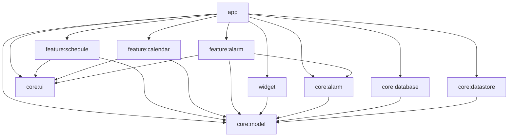

# Архитектура shift-alarm

Android-only приложение на Jetpack Compose. Это не Kotlin Multiplatform: модули собираются Android Gradle Plugin, кроме `:core:model`, который остаётся обычной JVM-библиотекой, чтобы чистые функции и тесты не тянули Android.

Сети нет. В манифесте нет `INTERNET`, логина, рекламы и Firebase. Если зависимость попытается протащить `INTERNET`, `ACCESS_NETWORK_STATE` или `AD_ID`, приложение вырезает их через `tools:node="remove"`.

Идентификаторы: `applicationId` и `namespace` приложения — `com.walhalla.shiftalarm`. `minSdk` 24, `targetSdk` 36, `compileSdk` 36.

## Граф модулей

Стрелка значит «зависит от». Фичи не зависят друг от друга и не видят Room/DataStore. Единственная точка сборки — `:app`.



## Правила слоёв

- `:core:model` не импортирует Android. Там домен, `ShiftCalculator`, `NextAlarmPlanner`, интерфейсы репозиториев и `HomeWidgetRefresher`.
- `:core:database` и `:core:datastore` реализуют репозитории. Наружу их классы не торчат: фичи получают интерфейсы через Hilt.
- `:core:alarm` владеет `AlarmScheduler`, `AlarmManager` и foreground-сервисом звонка. Он не знает про Compose и не зависит от фич. Экран звонка открывается через `RingingLaunchIntent`, реализацию которого даёт `:feature:alarm`.
- Фича не зависит от другой фичи. Навигацию между ними собирает `:app`.
- Виджет не зависит от фич. Данные он берёт из `ShiftRepository` и считает завтра через `ShiftCalculator`.
- Состояние экрана — `ViewModel` и `StateFlow<UiState>`. Компоненты не ходят в Room.

## Почему Hilt, а не Koin

Hilt проверяет граф при компиляции: пропущенный биндинг `ShiftRepository` или `RingingLaunchIntent` ломает сборку, а не первый запуск. Для этого скелета это важнее, чем простота Koin. Плюс штатные `@HiltViewModel` и `@AndroidEntryPoint` на `Activity`, `Service` и `BroadcastReceiver`, без своего service locator. Koin был бы уместен, если бы граф был маленьким и ошибки в рантайме были приемлемы. Здесь модулей десять, и контракт между ними должен рваться на KSP.

## Домен и шаблоны

`ShiftType` — слот цикла: `DAY`, `NIGHT`, `AFTER_NIGHT` (отсыпной), `OFF` или `CUSTOM` со своим именем, цветом и временем будильника. `alarmTime == null` значит «не звонить».

`ShiftPattern` — упорядоченный цикл и `startDate` (этот день соответствует индексу 0). Даты до старта тоже попадают в цикл через `floorMod`.

| Шаблон | Цикл, один слот = один календарный день |
| --- | --- |
| 2/2 | День 07:00, Ночь 19:00, Отсыпной, Выходной |
| 3/3 | День, День, День, Выходной, Выходной, Выходной |
| 1/3, сутки-трое | Сутки 08:00, Отсыпной, Выходной, Выходной |
| 5/2 | пять Дней и два Выходных, якорь — `startDate`, не понедельник |
| CUSTOM | любой непустой цикл, `ShiftTemplates.custom` |

Исключение на дату (`DayOverride`) заменяет слот паттерна целиком и не привязано к id графика: это свойство календарного дня. `AlarmException` на ту же дату либо глушит будильник, либо подменяет время.

```kotlin
object ShiftCalculator {
    fun shiftFor(
        date: LocalDate,
        pattern: ShiftPattern,
        overrides: Map<LocalDate, DayOverride> = emptyMap(),
    ): ResolvedShift
}
```

Пустой цикл — `IllegalArgumentException`. Тесты лежат в `:core:model` и гоняются на JVM.

Следующий будильник считает `NextAlarmPlanner.nextShiftAlarm`: первый слот строго после `now`, с учётом исключений, горизонт 366 дней. `NextTriggerSelector` оставляет один триггер: будущий snooze важнее ближайшей смены.

## Хранение

Room (`shift-alarm.db`, схема версии 1 в `core/database/schemas`) хранит то, что выбирают по дате и связывают:

- `shift_types` — встроенные и пользовательские типы;
- `patterns` и `pattern_slots` — цикл и флаг единственного активного графика;
- `day_overrides` — подмена смены на дату;
- `alarm_exceptions` — подмена или отмена будильника на дату.

Это строки с внешними ключами и выборкой «все дни месяца». Класть тот же граф в DataStore означало бы каждый раз переписывать весь документ.

DataStore Preferences (`shift_alarm_settings`) хранит скаляры, которые не ищутся по дате: минуты snooze, вибрацию, флаг `use_dynamic_color` (по умолчанию включён) и один маркер отложенного звонка (`pending_snooze_epoch_millis`, имя смены). Маркер нужен, чтобы после перезагрузки `scheduleNext` снова поставил именно snooze, а не сразу следующую смену. Это не таблица истории будильников.

Активный график живёт в Room (`patterns.isActive`), а не в DataStore: смена активного графика и запись цикла должны быть одной транзакцией.

## Контракты для UI и feature

Репозитории (`:core:model`):

```kotlin
interface ShiftRepository {
    fun observePatterns(): Flow<List<ShiftPattern>>
    fun observeActivePattern(): Flow<ShiftPattern?>
    fun observeShiftTypes(): Flow<List<ShiftType>>
    fun observeOverrides(): Flow<List<DayOverride>>
    suspend fun upsertPattern(pattern: ShiftPattern)
    suspend fun setActivePattern(patternId: String?)
    suspend fun upsertOverride(override: DayOverride)
    suspend fun deleteOverride(date: LocalDate)
}

interface AlarmRepository {
    fun observeExceptions(): Flow<List<AlarmException>>
    suspend fun upsertException(exception: AlarmException)
    suspend fun deleteException(date: LocalDate)
}

interface SettingsRepository {
    val settings: Flow<UserSettings>
    suspend fun setSnoozeMinutes(minutes: Int)
    suspend fun setVibrationEnabled(enabled: Boolean)
    suspend fun setUseDynamicColor(enabled: Boolean)
    suspend fun setPendingSnooze(epochMillis: Long?, shiftName: String)
}

interface HomeWidgetRefresher {
    suspend fun refresh()
}
```

Планировщик (`:core:alarm`). В очереди AlarmManager всегда не больше одного будильника.

```kotlin
interface AlarmScheduler {
    suspend fun scheduleNext(notBeforeEpochMillis: Long = System.currentTimeMillis())
    suspend fun cancelNext()
    suspend fun snooze(minutes: Int, shiftName: String)
    suspend fun dismiss()
    fun canScheduleExactAlarms(): Boolean
    fun canUseFullScreenIntent(): Boolean
}

interface RingingController {
    fun stop()
    fun snooze()
}

interface RingingLaunchIntent {
    fun create(shiftName: String, triggerAtEpochMillis: Long, snooze: Boolean): Intent
}
```

`AlarmPermissionIntents.requestExactAlarm` и `manageFullScreenIntent` открывают системные экраны. На API, где действия нет, методы возвращают `null`.

Состояние экранов — неизменяемые data class, их публикует `StateFlow`:

```kotlin
data class ScheduleUiState(
    val isLoading: Boolean = true,
    val patterns: List<PatternSummary> = emptyList(),
    val activePatternId: String? = null,
    val editor: PatternEditorUiState? = null,
    val errorMessage: String? = null,
)

data class CalendarUiState(
    val isLoading: Boolean = true,
    val month: YearMonth = YearMonth.now(),
    val days: List<CalendarDayUi> = emptyList(),
    val selected: CalendarDayUi? = null,
    val selectedDay: SelectedDayDetail? = null,
    val hasActivePattern: Boolean = false,
    val errorMessage: String? = null,
)

data class SettingsUiState(
    val isLoading: Boolean = true,
    val snoozeOptions: List<Int> = listOf(5, 10, 15, 20, 30),
    val selectedSnooze: Int = 10,
    val vibrationEnabled: Boolean = true,
    val useDynamicColor: Boolean = true,
    val canScheduleExactAlarms: Boolean = true,
    val canUseFullScreenIntent: Boolean = true,
    val errorMessage: String? = null,
)

sealed interface RingingUiState {
    data object Loading : RingingUiState
    data class Ringing(
        val shiftName: String,
        val triggerAtEpochMillis: Long,
        val snoozeMinutes: Int,
    ) : RingingUiState
    data class Error(val message: String) : RingingUiState
}
```

Маршруты NavHost, объект `ShiftRoutes` в `:core:ui`:

| Константа | Маршрут | Кто рисует |
| --- | --- | --- |
| `SCHEDULE` | `schedule` | `ScheduleRoute()` |
| `CALENDAR` | `calendar` | `CalendarRoute()` |
| `SETTINGS` | `settings` | `SettingsRoute()` в `:app` |

Звонок не маршрут NavHost. Его открывает `RingingActivity` (`singleInstance`, `showWhenLocked`, `turnScreenOn`, на API 24–26 те же флаги окна выставляются в коде).

Публичные composable фич: `ScheduleRoute`, `CalendarRoute`. Экран звонка — `RingingScreen(state, onStop, onSnooze)`.

## Жизненный цикл будильника

Планировщик ставит только следующий момент, через `AlarmManager.setAlarmClock`. Повтор всей серии в AlarmManager не кладётся.

1. Сохранили или выбрали график, либо сработали boot / смена времени / смена таймзоны / обновление пакета. `RescheduleReceiver` вызывает `scheduleNext()`.
2. `scheduleNext` читает активный паттерн, подмены дней, исключения будильника и маркер snooze. Если snooze строго позже границы — ставится он. Иначе `NextAlarmPlanner` ищет ближайшую смену. Нет кандидата — pending intent отменяется.
3. Если `canScheduleExactAlarms()` ложно, `setAlarmClock` не вызывается. Экран настроек ведёт в системный диалог.
4. Срабатывание приходит в `AlarmFireReceiver`. Он поднимает `RingingService` (`startForeground` с типом `specialUse`) и сразу вызывает `scheduleNext(notBefore = время этого срабатывания)`, чтобы следующий слот встал, даже если пользователь не нажмёт «Стоп». Граница `notBefore` не даёт поставить тот же момент ещё раз.
5. Сервис берёт `PARTIAL_WAKE_LOCK` (потолок 10 минут), показывает уведомление категории `alarm` с full-screen intent на `RingingActivity` и системным звуком будильника. Вибрация выбирает один из двух каналов.
6. «Стоп» вызывает `dismiss()`: маркер snooze стирается, снова считается следующая смена. «Отложить» пишет snooze в DataStore и заменяет единственный pending alarm. И активность, и кнопки уведомления идут в один `RingingService`.

`BOOT_COMPLETED` приходит после разблокировки. `LOCKED_BOOT_COMPLETED` сознательно не слушаем: в задании указан обычный boot. Если телефон перезагрузился и остался на блокировке, следующий будильник встанет после первой разблокировки.

## Матрица разрешений

| Разрешение | API | Как выдаётся | Зачем |
| --- | --- | --- | --- |
| `RECEIVE_BOOT_COMPLETED` | 24+ | manifest, normal | `RescheduleReceiver` после загрузки |
| `WAKE_LOCK` | 24+ | manifest, normal | не дать CPU уснуть, пока звенит |
| `VIBRATE` | 24+ | manifest, normal | канал с вибрацией |
| `FOREGROUND_SERVICE` | 24+ | manifest, normal | сервис звонка |
| `SCHEDULE_EXACT_ALARM` | 31–32, `maxSdkVersion=32` | специальное, экран настроек | `setAlarmClock`; проверять `canScheduleExactAlarms()` |
| `USE_EXACT_ALARM` | 33+ | normal, для будильника обычно уже выдано | то же `canScheduleExactAlarms()` |
| `POST_NOTIFICATIONS` | 33+ | runtime | без него уведомление и full-screen intent не появятся |
| `USE_FULL_SCREEN_INTENT` | 34+ | специальное, может быть отозвано | `canUseFullScreenIntent()`; на 24–33 полный экран доступен без этого разрешения |
| `FOREGROUND_SERVICE_SPECIAL_USE` | 34+ | manifest | тип сервиса `specialUse`, subtype `shift_alarm_ringing` |

До API 31 `canScheduleExactAlarms()` возвращает true: `setAlarmClock` на этих версиях не требует отдельного разрешения. Отдельного типа FGS «alarm» у платформы нет, поэтому звонок объявлен как `specialUse`.

Приёмники `BOOT_COMPLETED`, `TIME_SET`, `TIMEZONE_CHANGED`, `MY_PACKAGE_REPLACED` экспортированы и все ведут в `RescheduleReceiver`. `AlarmFireReceiver` без intent-filter и не экспортирован: его будит только явный pending intent.

## Виджет

Glance App Widget, подпись в списке виджетов: «завтра: смена/выходной». Текст считает `tomorrowLabel`: `завтра: ` плюс имя смены в нижнем регистре (`завтра: день`, `завтра: ночь`, `завтра: отсыпной`, `завтра: сутки`, `завтра: выходной`). Нет активного графика или цикл пуст — `завтра: выходной`. После записи графика `ScheduleViewModel` зовёт `HomeWidgetRefresher`.

## Каталог версий

Новее стабильные артефакты, у которых `minCompileSdk` в `aar-metadata.properties` равен 37, сюда не встают: у приложения `compileSdk` 36. Это Compose BOM `2026.08.00+` (Compose 1.12), `core-ktx` 1.19.x, lifecycle compose 2.11, navigation-compose 2.10.x, `hilt-lifecycle-viewmodel-compose` 1.4.0. Glance 1.3 ещё alpha.

| Компонент | Версия | Откуда |
| --- | --- | --- |
| Android Gradle Plugin | 9.5.0 | [maven-metadata AGP](https://dl.google.com/dl/android/maven2/com/android/tools/build/gradle/maven-metadata.xml), stable; API до 37, значит compileSdk 36 входит. Заметки: минимум Gradle 9.6.0 |
| Gradle | 9.6.0 | таблица совместимости AGP 9.5, не артефакт Google Maven |
| Kotlin | 2.4.21 | [kotlin-gradle-plugin](https://repo1.maven.org/maven2/org/jetbrains/kotlin/kotlin-gradle-plugin/maven-metadata.xml), последний stable. В AGP 9 Kotlin встроен, плагин `kotlin-android` не подключается; версию поднимает classpath в корневом `build.gradle.kts` |
| KSP | 2.3.13 | [symbol-processing-api](https://repo1.maven.org/maven2/com/google/devtools/ksp/symbol-processing-api/maven-metadata.xml). На Google Maven лежит устаревшая ветка 1.5.30. Документация KSP ставит 2.3.x рядом с Kotlin 2.4 |
| Compose BOM | 2026.06.01 | [compose-bom](https://dl.google.com/dl/android/maven2/androidx/compose/compose-bom/maven-metadata.xml). UI 1.11.4, `minCompileSdk` 35. Material3 в этом BOM — 1.4.0, `minCompileSdk` 35 |
| Room + компилятор | 2.8.5 | [room-runtime](https://dl.google.com/dl/android/maven2/androidx/room/room-runtime/maven-metadata.xml) |
| Hilt | 2.60.1 | [hilt-android на Maven Central](https://repo1.maven.org/maven2/com/google/dagger/hilt-android/maven-metadata.xml). На Google Maven артефакта нет |
| hilt ViewModel Compose | 1.3.0 | [hilt-lifecycle-viewmodel-compose](https://dl.google.com/dl/android/maven2/androidx/hilt/hilt-lifecycle-viewmodel-compose/maven-metadata.xml), `minCompileSdk` 35 |
| DataStore | 1.3.0 | [datastore-preferences](https://dl.google.com/dl/android/maven2/androidx/datastore/datastore-preferences/maven-metadata.xml) |
| Glance | 1.2.0 | [glance-appwidget](https://dl.google.com/dl/android/maven2/androidx/glance/glance-appwidget/maven-metadata.xml), последний stable |
| Glance preview | 1.2.0, только debug | [glance-preview](https://dl.google.com/dl/android/maven2/androidx/glance/glance-preview/maven-metadata.xml) (`minCompileSdk` 34) и [glance-appwidget-preview](https://dl.google.com/dl/android/maven2/androidx/glance/glance-appwidget-preview/maven-metadata.xml) (`minCompileSdk` 35). 1.3.0 ещё alpha |
| core-ktx | 1.18.0 | [core-ktx](https://dl.google.com/dl/android/maven2/androidx/core/core-ktx/maven-metadata.xml), `minCompileSdk` 36 |
| activity-compose | 1.13.0 | [activity-compose](https://dl.google.com/dl/android/maven2/androidx/activity/activity-compose/maven-metadata.xml), `minCompileSdk` 36 |
| lifecycle | 2.10.0 | [lifecycle-viewmodel-compose](https://dl.google.com/dl/android/maven2/androidx/lifecycle/lifecycle-viewmodel-compose/maven-metadata.xml) |
| navigation-compose | 2.9.8 | [navigation-compose](https://dl.google.com/dl/android/maven2/androidx/navigation/navigation-compose/maven-metadata.xml) |
| coroutines | 1.11.0 | [kotlinx-coroutines-android](https://repo1.maven.org/maven2/org/jetbrains/kotlinx/kotlinx-coroutines-android/maven-metadata.xml) |
| desugar_jdk_libs | 2.1.5 | [desugar_jdk_libs](https://dl.google.com/dl/android/maven2/com/android/tools/desugar_jdk_libs/maven-metadata.xml). Нужен `java.time` на API 24–25 |
| JUnit | 4.13.2 | Maven Central, последняя линейка JUnit 4 |
| Robolectric | 4.17 | [robolectric](https://repo1.maven.org/maven2/org/robolectric/robolectric/maven-metadata.xml), последний stable; `DefaultSdkProvider` включает API 36 |

Каталог: `gradle/libs.versions.toml`. Подпись release читает только `SHIFT_KEYSTORE_PATH`, `SHIFT_KEYSTORE_PASSWORD`, `SHIFT_KEY_ALIAS`, `SHIFT_KEY_PASSWORD`. Нет хотя бы одной — `signingConfig` не создаётся.

## Изменения T10b

Закрыты пробелы контрактов из PR экранов. Новых экранов нет: обработчики пишут в уже существующие репозитории, текущие заглушки только читают новые поля, чтобы собираться.

Для UI и feature:

- Календарь. Методы ViewModel, как в feature PR: `setOverride`, `clearOverride`, `setAlarmException`, `clearAlarmException`, `showMonth`. Те же имена у `CalendarEvent` (`SetOverride(date, shiftTypeId?)` и остальные). `shiftTypeId == null` снимает подмену. `CalendarUiState.selectedDay` — деталь выбранного дня.
- `errorMessage` во всех UiState — `UiText?` (`Res` / `Raw`, `resolve(context)`), тип в `:core:ui`. В PR фич своего `UiText` не было.
- Свой график остаётся в v1. `ScheduleUiState.editor: PatternEditorUiState?` (имя, дата старта, `slots: List<ShiftTypeId>`, `availableTypes`, текст проверки). События: `AddSlot`, `RemoveSlot`, `MoveSlot`, `SetName`, `SetStartDate`, `Save`. Длина цикла 1..31, это `PatternLimits`. `applyTemplate(CUSTOM)` открывает черновик, `Save` кладёт паттерн в Room и делает его активным.
- Настройки. `snoozeOptions = [5, 10, 15, 20, 30]`, выбранное значение — `selectedSnooze`. Событие `SettingsEvent.SelectSnooze`. Минуты вне списка отбрасываются.
- Динамический цвет. `UserSettings.useDynamicColor` в DataStore, ключ `use_dynamic_color`, по умолчанию `true`. `ShiftAlarmTheme(useDynamicColor)` подключает `dynamicLightColorScheme` / `dynamicDarkColorScheme` только на API 31+. Ниже остаётся своя палитра. Событие `SettingsEvent.SetUseDynamicColor`.
- Будильник. `RingingUiState` — sealed: `Loading`, `Ringing(...)`, `Error(errorMessage: UiText)`. Пока нет имени смены, состояние `Error`.
- `ShiftRepository.saveAndActivate` пишет цикл и единственный активный флаг одной Room-транзакцией.
- Direct boot. `RescheduleReceiver`, `AlarmFireReceiver` и `RingingService` — `directBootAware`. `LOCKED_BOOT_COMPLETED` и `USER_UNLOCKED` тоже зовут `scheduleNext`. Снимок активного графика, исключений и следующего триггера лежит в DataStore на `createDeviceProtectedStorageContext`. До разблокировки будильник ставится из снимка. После первой разблокировки снимок переносится в Room/DataStore, если своего графика ещё нет, и снимок обновляется из основного хранилища.
- Настройки. `notificationPermission`: `Granted` / `Denied` / `NotRequired` (ниже API 33). Флаги возможностей: `exactAlarm`, `fullScreenIntent`.
- Robolectric 4.17 (Maven Central, stable, SDK 36 есть в `DefaultSdkProvider`) подключён как `testImplementation`. Один тест `ShadowAlarmManager` проверяет, что `scheduleNext` вызывает `setAlarmClock`.
- Glance preview 1.2.0 совместим с compileSdk 36 и подключён только в debug `:widget` (`glance-preview`, `glance-appwidget-preview`). Отдельный `@Preview` виджета в этой задаче не добавлялся.
- Общий идентификатор типа для контрактов — value class `ShiftTypeId`. Список типов для выбора: встроенные плюс сохранённые, `ShiftRepository.observeShiftTypes()`.
